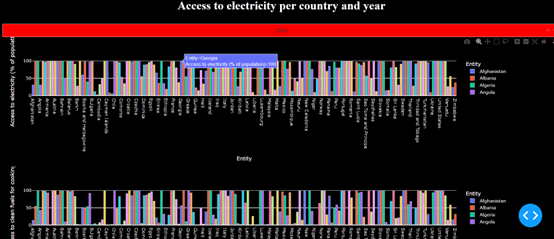
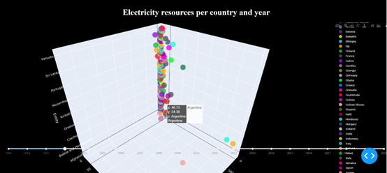
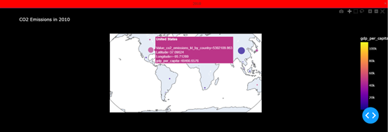

## The idea

An interactive dashboard of **ESG metrics for many countries since 2000**, served with Dash.

## What is inside

1. **Bar plots** of access to electricity per country and year
2. A **3D scatter plot** of electricity sources per country and year
3. A **geo plot** of CO₂ emissions and GDP per country and year

## Screens

<table>
<tr><td width="100%" valign="top"><br><sub>Access to electricity per country and year</sub></td></tr>
<tr><td width="100%" valign="top"><br><sub>Electricity sources per country and year</sub></td></tr>
<tr><td width="100%" valign="top"><br><sub>CO₂ emissions and GDP per country</sub></td></tr>
</table>

## Run it

`requirements.txt` is a full freeze of the original environment. The app itself needs only three packages:

```bash
pip install pandas plotly dash
python train.py   # starts the Dash app
```

The data is [`global-data-on-sustainable-energy.csv`](global-data-on-sustainable-energy.csv).

## Built with

`Python` · `pandas` · `Plotly` · `Dash`

<br>

<p align="center"><sub><a href="https://github.com/johnnyk1090">← back to the profile</a></sub></p>
